# 插件管线图（自动生成，勿手改）

刷新命令: `python3 skills/project-viz/scripts/workflow_flow.py workflow.yaml --inplace docs/pipeline-viz.md`（改 workflow.yaml stages 后重跑）。

```mermaid
flowchart LR
    subgraph MAIN["计算主线（A9/VNAR 实证）"]
    family-identification["阶段1 家族归属 / 同源检索<br/>seq-struct-analysis"]
    structure-acquisition["阶段2 结构获取 (实验结构优先, AI预测兜底)<br/>structure-prediction-analysis"]
    structure-analysis["阶段3 结构质量与功能位点分析<br/>structure-prediction-analysis"]
    md-validation["阶段4 分子动力学验证 (动力学稳定性/结合模式)<br/>md-simulation-workflow"]
    binding-energy["阶段5 结合能定量 / 机制深化<br/>md-simulation-workflow"]
    family-identification -->|"homologs、structure_neighbors"| structure-acquisition
    structure-acquisition -->|"structure、confidence"| structure-analysis
    structure-analysis -->|"quadrants、pocket"| md-validation
    md-validation -->|"topology、trajectories、stabil"| binding-energy
    end
    subgraph CHAIN["科研全链路（收编技能）"]
    research-ideation["阶段0a 文献调研与研究构思<br/>scispark"]
    research-planning["阶段0b 采集前实验设计与预注册<br/>experiment-design"]
    statistical-validation["阶段5b 采集后验证性统计<br/>statistical-analysis"]
    writing["阶段6 学术写作与润色<br/>academic-writing"]
    review["阶段7 论文审查与引用合规<br/>papercheck"]
    presentation["阶段8 成果展示 (PPT/视频/配图)<br/>visual-deck-builder"]
    research-ideation -.- research-planning
    research-planning -.- statistical-validation
    statistical-validation -.- writing
    writing -.- review
    review -.- presentation
    end
    binding-energy -.->|"候选/数据"| research-ideation
```

<!-- PIPELINE-VIZ -->

<!-- /PIPELINE-VIZ -->
