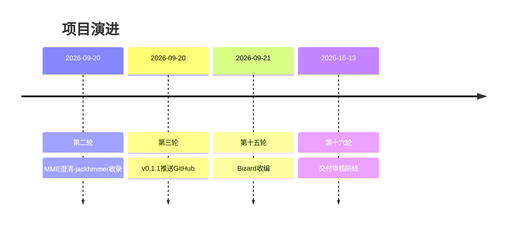
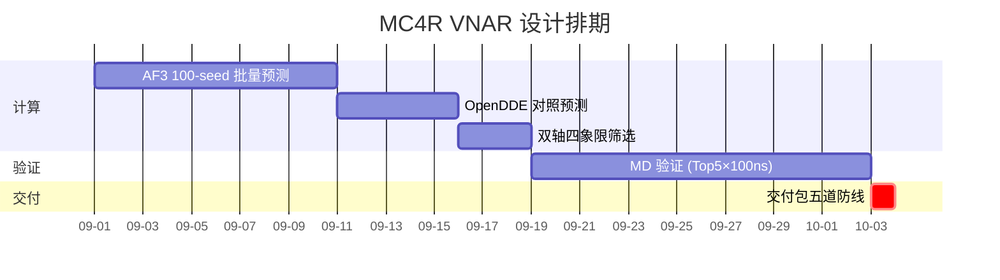
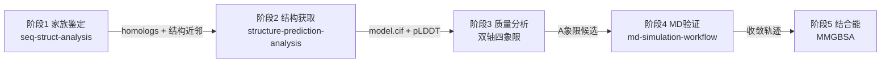
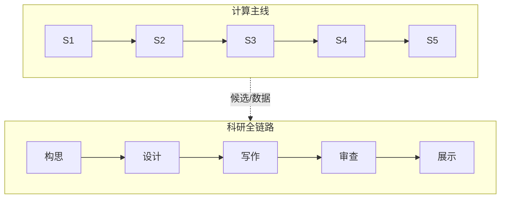
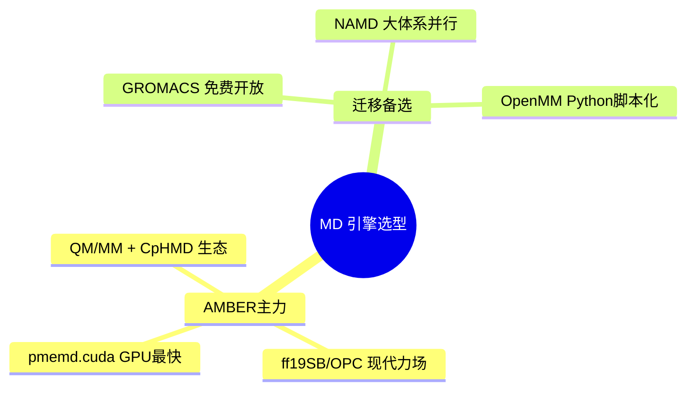
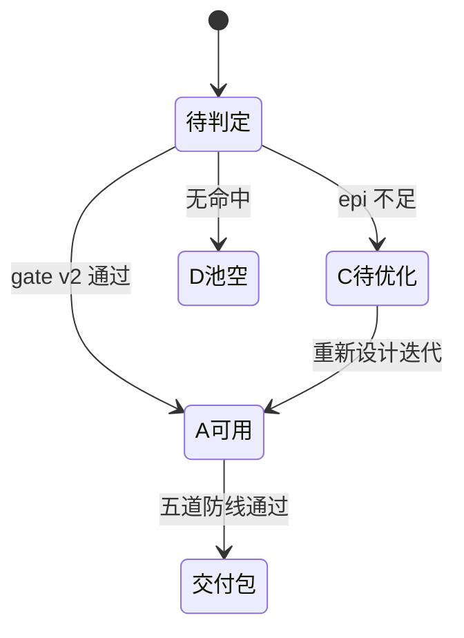
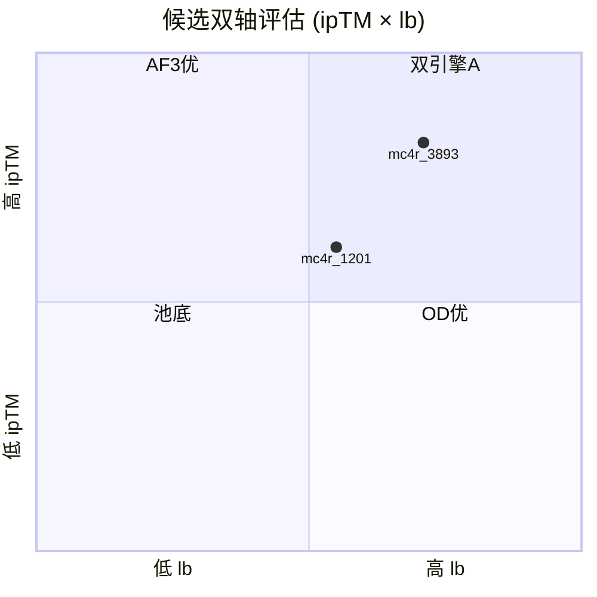

# Mermaid 科研项目场景配方手册

按使用频率排列。所有示例已过 GitHub 渲染验证写法；生成后务必在目标环境渲染确认。

## 1. timeline——项目进程时间线（handoff 首选）

要点：
- 每行 = `日期 : 事件1 : 事件2 : ...`（可多段，渲染成堆叠卡片）
- **文本内禁英文冒号 `:`**，用全角"："
- 同日期多轮自动归到同一时间点下，天然适配 handoff 多轮同日场景

## 2. gantt——有工期的排期

要点：
- `after a1` 声明依赖；`crit` 红色关键路径；日期必须 `YYYY-MM-DD` 无引号
- 排期图（未来计划）用 gantt，历史回顾用 timeline——勿混

## 3. flowchart LR——pipeline 数据流

要点：
- `LR` 左到右（管线）；`TB` 上到下（层级）
- 边上标签 `-->|"产物"|` 写数据流转契约（= workflow.yaml 的 outputs→inputs）
- ` ` 节点内换行；文本含括号必须引号包裹
- **超 12 节点拆 subgraph**：

（`-.->` 虚线 = 弱耦合/可选流转）

## 4. mindmap——知识/方法体系

要点：
- 缩进即层级，**不能有连线/标签语法**
- 根节点 `root((文本))`；每层缩进统一（2 或 4 空格，勿混）

## 5. stateDiagram-v2——状态迁移（判定流程）

## 6. quadrantChart——双轴候选评估

要点：坐标 [0-1, 0-1]；与双轴四象限分析（structure-prediction-analysis）的语义映射：
quadrant-1 右上 = A（双引擎一致），适合给非技术干系人看的摘要版。

## 7. 渲染环境与导出

| 环境 | 状态 |
|---|---|
| GitHub（README/issue/PR 评论） | 原生渲染，\`\`\`mermaid 代码块即可 |
| Trae / VSCode Markdown 预览 | 装 "Markdown Preview Mermaid Support" 扩展 |
| Typora / Obsidian | 原生支持 |
| 导出 PNG/SVG | `npm i -g @mermaid-js/mermaid-cli && mmdc -i x.md -o x.png -s 2` |

## 8. 通用守则

1. 生成后**必须在目标环境渲染验证**——mermaid 语法错误表现为整图空白而非报错
2. 文本三禁：英文冒号、未引号包裹的括号、行尾反斜杠
3. 图是文档的一部分：进度图内嵌 handoff（PROGRESS-VIZ 区），管线图入 docs/ 并在 README 链接
4. 每次更新 handoff 后重跑生成脚本刷新图（见 SKILL.md 维护约定）
